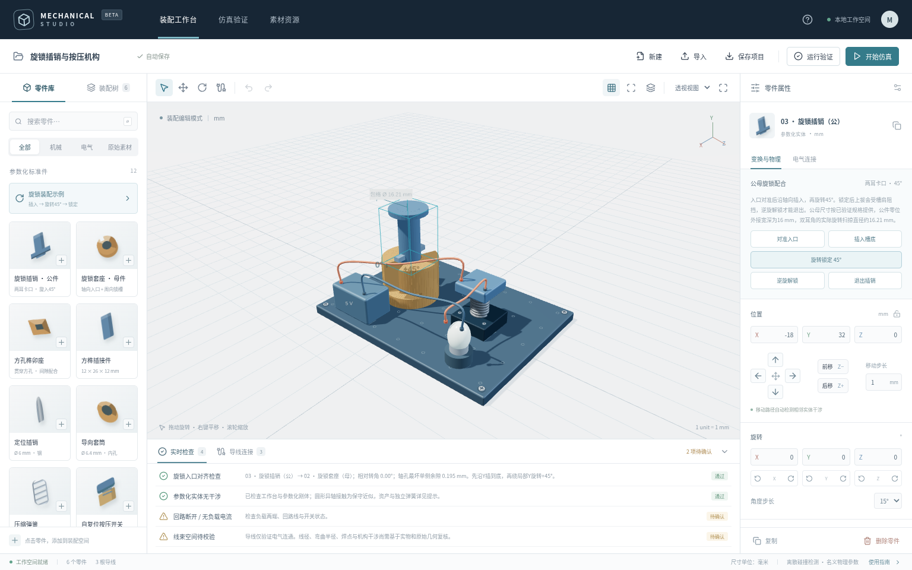

# Mechanical Studio

机械零件装配与仿真工作台。客户端使用毫米单位，提供三维零件库、精确位移与旋转、相邻零件干涉预检、榫卯配合检查、弹簧按压回弹，以及电源、开关、灯和电阻的直流电路验证。仓库同时保留 pureTV Wi-Fi 手柄的 Blender 原始素材、装配基线和设计历史。

这是可运行的工程预检工具。计算依据参数化碰撞体和简化物理模型；原始手柄资产的显示与包围盒预检不能证明其复杂曲面、旋锁、弹簧和线束已经通过实体装配验证。完整适用范围见 [验证方法与精度边界](docs/VALIDATION.md)。



## 启动

需要 Node.js 22 或更新版本、npm，以及支持 WebGL 的浏览器或桌面图形环境。

```bash
npm install
npm run dev
```

打开命令输出的本地地址。Vite 开发服务监听所有网络接口；只需本机访问时使用 `npm run dev -- --host 127.0.0.1`。

作为独立桌面窗口启动：

```bash
npm run desktop
```

该命令先构建前端，再启动 Electron。桌面应用从本地包加载资源，不依赖开发服务器；操作系统的另存为对话框用于工程与报告导出。桌面运行需要图形环境和操作系统所需的 Electron 运行库。

## 使用

1. 在左侧零件库添加机械或电气零件，也可载入已有手柄素材。点击「旋锁装配示例」，选中公件后依次使用「插入槽底 → 旋转锁定 45°」。此时退出应受阻；逆旋解锁后可完全退出。
2. 在「原始素材」中可打开原手柄装配。选择一个原始总成后，右侧「拆分为独立零件」可将其键帽、弹簧、套筒等分开编辑；当前清单共 15 个集合、189 个对象。
3. 单击场景或装配树选中零件。右侧使用毫米坐标、角度、移动步长和方向按钮调整位置；移动与旋转会检查沿途干涉。固定件需要先解除固定才能移动。
4. 检查孔宽、榫头尺寸和公差，再沿配合轴插入。几何不相交只代表当前代理几何无干涉，还需要读取配合与容差检查结果。
5. 添加电源、按压开关、灯和电阻，通过端子创建导线。运行后按压开关，观察回弹、接通状态和灯的变化。导线必须形成有效回路。
6. 运行验证，阅读每条错误与待确认项。修改结构后重新验证，并导出工程 JSON 保存当前零件、参数和连线；重新导入可以继续编辑。

鼠标拖拽可环绕观察，滚轮缩放；视图工具可切换观察方向、网格、透视显示与爆炸显示。爆炸显示用于观察内部结构，不改变工程的实际装配坐标。

本次实际执行的检查见 [交付检查记录](docs/verification-summary.md)。

## 构建与检查

```bash
npm test
npm run test:e2e
npm run verify:demo
npm run verify:bayonet
npm run assets:verify
npm run build
npm run preview
```

浏览器测试优先使用系统 Chromium，可通过 `PLAYWRIGHT_CHROMIUM_PATH` 指定；没有系统 Chromium 时先运行 `npx playwright install chromium`。直插方榫示例的可复现计算结果见 [验证记录](docs/demo-verification.json)，包含插入、阻挡、0.100 mm 最不利单侧余隙、50 mA 点灯及按压回弹结果。

桌面目录构建：

```bash
npm run desktop:pack
```

生成的本地开发目录位于 `release/`。当前仅发布 **macOS Apple Silicon（M 系列，arm64）** 安装包；需要 macOS 12 或更新系统。GitHub Actions 在推送匹配 package 版本的 `vX.Y.Z` 标签后，自动验证、构建并发布 DMG、ZIP 与 SHA-256 校验清单。

M 系列 Mac 上也可本地构建与检查：

```bash
npm run release:mac
npm run release:mac:verify
npm run release:mac:smoke
```

目前使用 ad-hoc 签名，尚未进行 Apple Developer ID 签名或公证。首次打开可能需要在系统「隐私与安全性」中批准此应用。完整发布、验证和安装流程见 [macOS 发布说明](docs/RELEASING.md)。

## 新增旋锁公母件

公件两耳沿母件轴向入口装入，转动进入 L 形槽。采用相同顶点生成渲染、碰撞体、可编辑 Blender 场景和独立 STL，最坏公差组合下轴孔单侧余隙约 0.195 mm、槽高单侧余隙 0.200 mm。完整过程与尺寸见 [旋锁验证报告](docs/bayonet-verification.json)，试印文件与重建方法见 [模型说明](docs/bayonet-assets.md)。旋锁样件需要实物标定后再移植到原手柄。

## 现有手柄素材

- [Blender 素材和导入方法](assets/puretv-controller/README.md)：15 个原始集合，使用统一毫米装配坐标。
- [素材清单](assets/puretv-controller/manifest.json)：原文件校验值、对象名称与装配矩阵。
- `public/models/`：供客户端加载的 GLB 显示副本；`catalog.json` 记录显示尺寸和来源。
- [显示副本的导出说明](docs/assets.md)：转换、简化和几何诊断信息。
- [当前手柄设计与实体验证顺序](AGENTS.md)。
- [按时间排列的用户需求与截图](history/README.md)。

重新生成显示副本需要安装 Blender 5.2.2 或更新版本：

```bash
npm run assets:export
```

导出脚本读取原始 `.blend` 并生成客户端资源，不覆写原始设计。显示副本可能经过网格简化，精密尺寸复核仍应回到原始模型。

## 工程结构

| 路径 | 内容 |
| --- | --- |
| `src/` | React 客户端、三维视图和工程数据 |
| `src/engine/` | 几何、运动、弹簧与电路计算 |
| `tests/` | 物理与装配规则回归测试 |
| `electron/` | 隔离的桌面窗口与本地资源协议 |
| `scripts/` | Blender 素材导出 |
| `assets/puretv-controller/` | 可编辑的原始机械素材 |
| `docs/` | 验证方法和模型转换说明 |

软件代码许可见 [LICENSE](LICENSE)。手柄中改编的 PS5 外观素材来源为 Taohid Animation 的 [PS5 Controller](https://sketchfab.com/3d-models/ps5-controller-b7bb9c5102a04cb0b1966c6d02bad7d6)，使用 [CC BY 4.0](https://creativecommons.org/licenses/by/4.0/)；相关显示副本继续保留此署名，详见 [素材说明](assets/puretv-controller/README.md#模型出处)。
