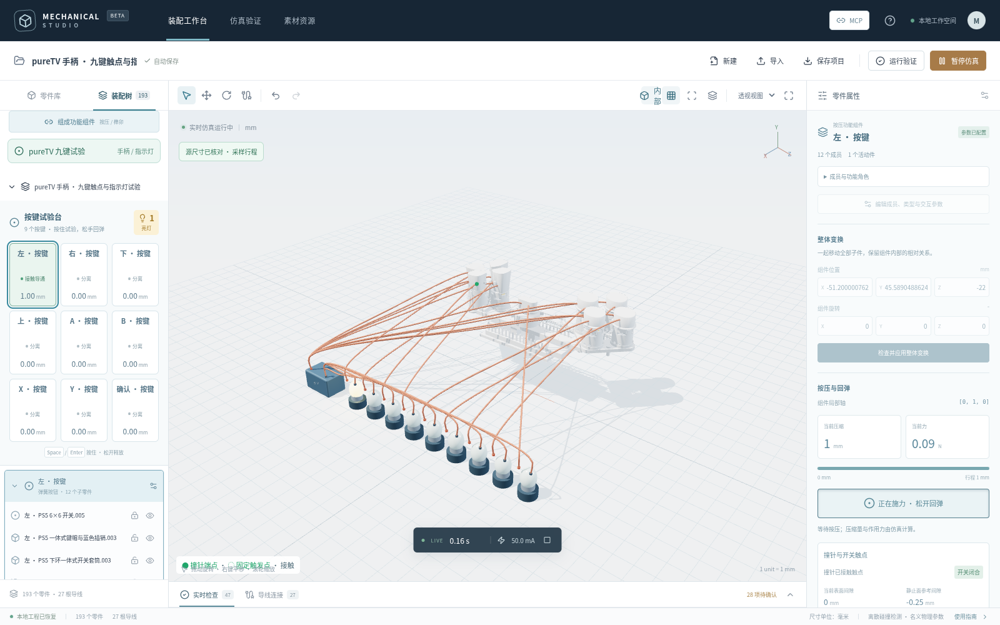

# pureTV 九键手柄试验

pureTV 示例把左、右、上、下、A、B、X、Y 和确认键组成九个独立按压组件，并接入九盏外部指示灯。手柄保留 15 个来源集合中的 **183 个独立子零件**；方向键没有合并成一个物件。八个上弹簧定位环已分别与对应键帽合为实际打印件，原来的 189 个对象因此成为 181 个，再增加确认开关的两个独立金属焊脚。配合小组和功能组件仍保留成员关系，便于逐件选择、检查和修改。

## 在客户端中试验

1. 点击左侧 **pureTV 九键试验 · 手柄 / 指示灯**，载入手柄、5 V 试验电源和九盏指示灯。工程共 193 个零件、9 个按压组件、27 根逻辑导线。
2. 点击视图上方的 **内部**，隐藏上下外壳，观察键帽、弹簧、导向座和开关。隐藏只影响显示，外壳仍参与碰撞检查。再次点击可恢复外壳。
3. 查看实时检查，再点击 **开始仿真**。在 **按键试验台** 上按住任意键，松手释放；按钮获得焦点后也可按住空格或 Enter。失去窗口焦点会释放当前按键。
4. 逐键观察行程、接触状态和亮灯数量。撞针尚未碰到触头时应保持断路；接触后只点亮该键对应的指示灯，释放后回弹并熄灯。选择该功能组件，可在右侧查看触点间隙、横向偏差及允许过行程。
5. 使用 **运行验证** 查看逐项结果，并按需要导出工程或验证报告。示例名称和载入成功本身不表示尺寸验证通过，应查看当前证据状态与报告内容。

装配树中仍可选择单个子件并修改名称、颜色和 PBR 外观。颜色、金属度、粗糙度不会自动改变质量、弹簧刚度或材料强度。功能组件的成员受共同运动约束；要改变机械构型，应先编辑组件定义，避免单独移开撞针或基座而继续使用旧校准。

## 按键实际怎样工作

| 部件 | 按压时的作用 |
| --- | --- |
| 键帽、与其一体的上插销/撞针 | 作为活动子组沿导向轴移动；ABXY 标识跟随所属键帽 |
| 回弹弹簧 | 上端随键帽压缩、下端保持在支承位置；释放后由质量、弹簧和阻尼模型计算回弹 |
| 导向套筒或确认座 | 约束按压方向并支承机构；正常按键试验中保持固定 |
| 开关触头/柱塞 | 接触前静止，撞针碰到后随动，最大移动 0.25 mm |
| 固定电气开关主体 | 保持原位，导线连接它的端子；电气通断由撞针与实际触头的接触决定 |
| 确认开关的两个金属焊脚 | 固定在塑胶主体的局部安装孔中，分别接 GPIO 与 GND 线；金属接头和塑胶主体独立建模 |

本示例静止间隙为 **0.75 mm**，总按压行程为 **1 mm**。前 0.75 mm 是接近过程，之后触头随撞针移动最多 **0.25 mm**。程序按变换后的实际接触点、法向和横向落点判断通断，不把“按下了按钮”或达到某个旧阈值直接当作开关闭合。触头跟随后的显示面贴合，也不能掩盖超出允许行程的压入。



九盏灯与导线是外部功能试验台：每路使用 5 V 电源和 100 Ω 的名义灯负载，理想闭合电流为 50 mA。这验证独立按键的接触和电路连通关系，不代表 ESP32 固件、实物 LED 驱动、电池保护或最终线束已经完成。

## 八个主键与确认键的安装方式不同

以下位置以源模型的装配原位为零，轴向单位为 mm；角度按源 +Z / 客户端 +Y 轴的右手方向计量。源坐标转换为客户端时使用 `(x, y, z) → (x, z, -y)`，示例对全部子件统一抬高 `[0,20,0]`，保持它们的原始相对位置。

| 安装副 | 入口与锁定路径 | 注意事项 |
| --- | --- | --- |
| 四方向键与 ABXY 的套筒 ↔ 对应底板 | 以 **−25°** 对准入口，沿轴插入到原位以下 **0.25 mm**，转回 **0°**，再回到原位坐定 | 共八组。拆卸先下压 0.25 mm，逆序旋转后退出；应在合上外壳前完成安装 |
| 确认旋锁座 ↔ 上盖内侧锁槽 | 以 **+30°** 从下方插入，相对原位再上抬 **1 mm**，转回 **0°**，下落 1 mm 坐定 | 必须打开外壳操作；座、开关主体和焊脚一起装入，锁定后再连接两条线；键帽与确认座之间是按压导向 |

确认座的两个锁耳由上盖局部承载面支撑，原位直接下拔会受到阻挡。安装时上抬会额外压缩确认弹簧；按自由长度约 3.2398 mm、保守并圈长度 1.75 mm 估算，1 mm 装配压缩后仍有约 0.4898 mm 余量。这里是几何与名义参数检查，未测定装配力、摩擦或长期保持力。

确认开关主体与座之间留有独立安装腔，GPIO 与 GND 线分别接到两个金属焊脚。装座上抬时，触头碰到保持在原位的撞针后可相对开关主体回缩最多 0.25 mm；随后落座恢复静止间隙。金属脚与塑胶主体的固定界面、导线端部的焊接区各有局部定义，仍需分别核验。

这些路径来自对应源网格，不是所有素材都通用的旋锁规则，也不能直接套用内置标准双耳代理的锁定角。详细修形与测量见 [源尺寸与功能校准](puretv-geometry.md) 和 [确认座安装修正](puretv-geometry-confirm-mount.md)。

## 用真实 MCP 重现九键试验

先安装包含本版素材的 macOS Apple Silicon 构建；在源码目录执行以下命令。脚本会新建试验工程并操作实际工作台，还会更新源码目录中的示例工程和执行记录。需要保留已有工程时先导出。下面为实验单独建立应用数据目录；GUI 和 MCP 客户端必须使用同一个目录。

```sh
npm ci
export MCP_NATIVE_BINARY="/Applications/Mechanical Studio.app/Contents/MacOS/mechanical-studio"
export MECHANICAL_STUDIO_DATA_DIR="$(mktemp -d "${TMPDIR:-/tmp}/mechanical-puretv.XXXXXX")"
"$MCP_NATIVE_BINARY" &
```

等待工作台打开，在顶部 MCP 面板确认服务已启用，再执行：

```sh
node scripts/mcp-client.mjs get_runtime_status
npm run mcp:drive-puretv -- --require-evidence
```

应用安装位置不同时，修改 `MCP_NATIVE_BINARY`。运行状态必须对应这次打开的真实工作台；未就绪时先等待素材加载。`--require-evidence` 要求源证据与当前工程匹配且为 pass，不能用未知状态替代成功。

[驱动脚本](../scripts/drive-puretv.mjs) 经官方 MCP 客户端调用原生 `--mcp` 服务，依次加入全部来源集合、配置九个组件、添加电源与灯、接线，并逐键检查接触前断电、接触导通、释放断电。它还读取实际渲染对象，核对键帽、弹簧和触头确实运动、固定件保持不动，而不是只检查一个独立计算结果。每次写入均携带当前 revision。

成功执行后会生成 `docs/puretv-mcp-verification.json` 与 `public/models/puretv-verified-assembly.json`。记录中的 `nativeDesktop` 区分打包 WKWebView 与开发浏览器通路；Chromium 开发验证不能代替 macOS 打包应用复验。协议、单步工具调用和开发通路见 [MCP 使用说明](MCP.md)。本版执行结果见 [交付检查记录](verification-summary.md)；应使用与当前构建和装配一致的记录。

v0.4.1已在实际macOS arm64打包应用中完成同一九键试验，源证据匹配、接触点灯和回弹断电均通过；见[完整Mac MCP记录](releases/v0.4.1/puretv-macos-mcp-verification.json)、[来源与哈希](releases/v0.4.1/provenance.json)、[附件校验](puretv-macos-release-verification.json)及[发布流水线](https://github.com/ecojust/Mechanical-Simulation/actions/runs/43596336457)。

## 修改模型后怎样理解验证结果

源网格证据绑定具体源文件、显示模型、成员位置、功能参数和已覆盖行程。修改尺寸、配合面、零件位置、成员关系或机械参数后，原证据可能失效；应重新导出、校准并审计。界面中的 **unknown** 表示尚无匹配证据，预览不能当作通过；匹配到明确失败的源证据会阻止按压试验。单纯修改显示颜色不等于修改几何，但仍不能据此推断真实材料性能。

上传自己的 GLB/STL 时，需要声明组件类型、尺寸、代理轴和锚点。插销/榫卯还需提供公母角色、配合尺寸、插入深度、余隙和公差；复合按钮需设置固定、活动、弹簧、触头与电气主体角色，以及接触点、有效触发区和允许行程。缺少必需参数时可以保存预览，不能通过功能校验。任意上传模型不会自动继承 pureTV 的源网格证据。详见 [组件定义](COMPONENTS.md) 与 [复合功能组件](MECHANISMS.md)。

请分别理解三类结果：

- **源网格检查**使用完整 Blender 求值网格，在记录的姿态检查表面交叉、内部点及局部接触。离散路径不等于连续碰撞证明；采样最近距离不是全局最小间隙下界。
- **名义力学与电路仿真**使用声明的质量、线性弹簧、阻尼、接触行程和理想电路。当前质量、弹簧刚度等包含材料假设，不包含实测开关反力、摩擦、偏心卡滞、磨损或材料变形。
- **实物制造验证**还需确认打印/加工公差、材料强度、弹簧规格、装配力及真实开关额定行程。模型中的圆柱触头要求匹配的实物规格，不能用不同外形的开关沿用原结论。

源报告、功能执行记录和 macOS 发布烟测分别回答不同问题；只有与同一构建和构型匹配的记录才可一起用于评估。
