# pureTV 手柄项目提示词历史 · 2

按用户消息出现的顺序存档。截图随对应消息保留。

## 060

继续

## 061

应该是本地起一个socket服务端，然后esp32连接这个服务

## 062

你给esp32提供一个网页，用mdns固定地址访问，然后可以手动连接局域网，点击链接之后自动重启连接局域网

## 063

[esp32-socket-test.local](http://esp32-socket-test.local/)    密码不要了吧

## 064

好了

## 065

不是电脑打开 [esp32-socket-test.local](http://esp32-socket-test.local/)  么

## 066

这个mdns改成puretv.local; 然后配网页面，自动获取wifi列表，填写密码，然后Mac 服务端 IP 或主机名这个改成游戏主机地址

## 067

wifi看列表没有啊，还是输入

## 068

选择附近的wifi怎么还是没有扫描出列表

## 069

esp32的这个热点看不到了额

## 070

可以了，能够选择之后，这个wifi名称输入就移除吧

## 071

页面样式弄好看点，组件样式统一，然后这个esp32的热点名称改成puretvTV-joystick，意思是给puretv配置的手柄

## 072

名称下拉框的样式和其他输入组件样式高度这些不统一

## 073

输入之后重启，就搜不到这个`puretvTV-joystick` 热点了

## 074

因为这个配网的地址要作为二维码贴在手柄上的，所以最好这个二维码地址能够在`puretv.local` 和 实际的ip之间切换

## 075

所以首次配网就会启用 `puretv.local`这个热点，自动连接局域网之后，这个`puretv.local`就不会打开了

## 076

我现在局域网设备地址可以打开，[http://puretv.local/](http://puretv.local/) 打不开

## 077

然后这个已经配好网之后，页面应该显示已经选择的网络以及密码

## 078

那刚才是什么原因呢

## 079

当前电脑的ip地址是多少，我要测试这个socket服务连接

## 080

保存并重启之后，网页打不开了

## 081

更新之后，这个wifi名称不对啊

## 082

扫描出来的列表不对

## 083

显示wifi扫描失败

## 084

正在扫描wifi，过了一会还是扫描失败

## 085

这下扫描成功了，重启之后局域网设备地址 和 [http://puretv.local/](http://puretv.local/) 也都能访问了，你需要把这个经验记录下来；
然后你帮我看一下，socket有没有连接

## 086

你需要给这个esp32添加一个子页面 [http://puretv.local/](http://puretv.local/)status。 查看当前socket连接状态；然后把这个断线重连一起做掉

## 087

接下来定义引脚了：上下左右，start，abxy一共9个按键，支持点按和长按的检测，你的socket服务应该需要添加这个日志输出，是哪个手柄触发了什么事件

## 088

你提供一个网页试试监测手柄和socket服务的连接状态，以及每个手柄按键的状态，触发的时候，按键点亮

## 089

针脚触发几次之后，很容易失灵

## 090

[http://127.0.0.1:8766/](http://127.0.0.1:8766/) 这个页面显示，一个灯都不亮

## 091

- 问：请现在把 A 键的 GPIO 13 接到 GND 并保持约 3 秒，再松开。你正在测的是哪一个 GPIO？
  答：27

## 092

- 问：GPIO 27 对应 START。请把板上标为 27／IO27 的针脚接到 GND，保持 5 秒再松开，然后回复「已测」。
  答：已测

## 093

这个长按导师可以，点按好像有点延迟

## 094

就是点按，按下之后，要过500ms灯才灭

## 095

不要只该监测页面啊，监测页面要跟实际保持完全一致

## 096

所以这个灵明度是40ms是吧

## 097

那么这个灵敏度和性能的考量下，可以优化么

## 098

目前看上去效果良好，你git init一下，把目前这个代码作为0.1 稳定版

## 099

你把这个esp32的设计流程以及功能写一个公众号文章

## 100

具体参数部分不需要说明，主要就是当个故事把事情讲清楚就好了

## 101

还要设计一个封面图

## 102

readme中需要一个表格列出来每个按键按下的时候，发送的socket消息是什么

## 103

seq是什么，`controller_id`每个手柄烧录的时候应该不一样吧

## 104

所以`controller_id` 一定是不同的

## 105

然后给出一些socket服务端的代码示例

## 106

这个可以加一个引脚，实现按下时自动搜索局域网内所有的puretv的socket服务么

## 107

所以socket服务端，要怎么定义呢

## 108

安卓客户端可以注册mDNS么

## 109

你把这个安卓客户端的实现细节记录到readme中

## 110

esp32 添加一个搜索并连接的按键引脚

## 111

所以能够自动连接的游戏必须实现 `_puretv._tcp` 这个服务接口

## 112

你把这一对游戏app的要求提交到 [https://github.com/ecojust/pureTV](https://github.com/ecojust/pureTV) 仓库的agents.md 中

## 113

你没有将所有按键的通讯字段提交上去

## 114

新加的GPIO 23，不需要通讯协议的定义么，还是说只要实现了`_puretv._tcp`就可以

## 115

注册时用 `NsdServiceInfo` 填这几个字段，这些说明需要遵守吧

## 116

那将这个要求也提交上去

## 117

你再做一个虚拟的手柄页面，来测试真实的应用，这样别人实现游戏之后，可以用这个页面来测试（当他没有手柄的时候）
子哟好了一并提交上去，然后单独添加一个文件夹叫puretv-joystick，里面将刚才的手柄测试页面以及游戏支持手柄的一些要求全部同步过去，所以以后开发puretv的手柄游戏参考这个文件夹里的说明就好了

## 118

继续

## 119

然后再提供一些puretv-joystick的sdk，这样别人可以直接用这个sdk来做一个虚拟的puretv-joystick；
然后你也需要将最新的esp32固件，上传到这个文件夹

## 120

所以这个配网页面，下面的游戏主机地址可以不填的，这样的话，就可以完全通过新加的GPIO 23来实现主动搜索了

## 121

密码显示与否在后面加个眼睛；游戏主机以及端口这个选填的用checkbox，勾选之后展开可以填

## 122

这个手柄模型有问题，按钮安不上去；你找找有没有现成的适合3d打印的手柄

## 123

你把这几个模型都下载下来，blender的mcp已经有了

## 124

blender打开已下载的模型

## 125

分开看一下

## 126

你可以去 [https://sketchfab.com/search?q=joystick&type=models](https://sketchfab.com/search?q=joystick\&type=models) 下载模型

## 127

downloads文件夹已经下载了 ps5-controller

## 128

你打散一下看看内部结构

## 129

复制一个新的，然后进行后续修改

## 130

【1208强光常开带锁电源手电筒按钮开关点动按压式手电筒按键开关】复制￥SB4ENeI646Vai￥，打开【手机阿里】或【支付宝-点首页进行搜索】查看：https\://qr.1688.com/s/WjAOp1Nn CZ9685。 我打算用这个里面的开关接入进去，你综合一下尺寸，选一个合适的，然后进行组装

## 131

12 × 8 mm 的两脚常开自复位款。是哪一个，截图我看看

## 132

【供应轻触开关6\*6插件3\*6贴片4\*4/4.5\*4.5插脚2\*4\*3.5侧按按键系列】复制￥NUSV1FY64TLay￥，打开【手机阿里】或【支付宝-点首页进行搜索】查看：https\://qr.1688.com/s/x0TviK7m CZ6273。这个是自复式的

## 133

贴片和插脚有什么区别

## 134

<image name=[Image #1] path="[本机路径已脱敏]">

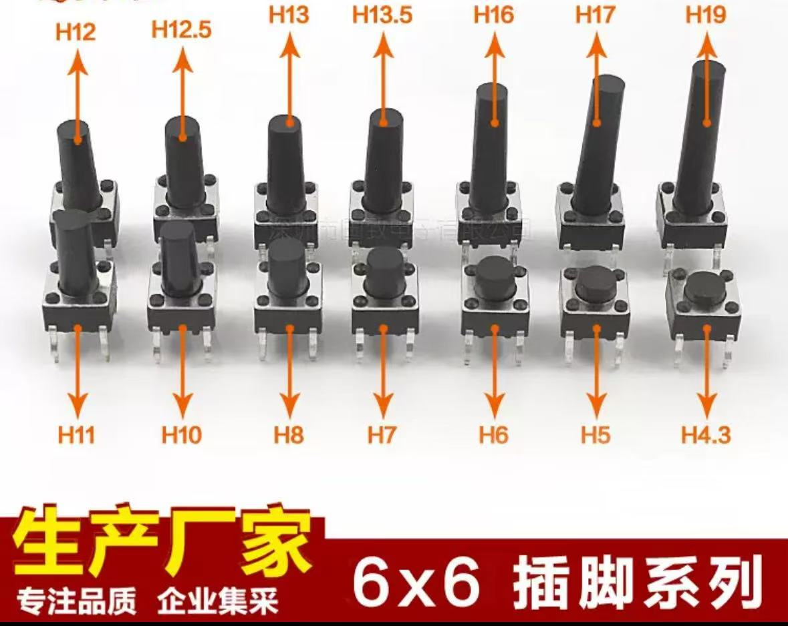

</image>

## 135

那你继续在 PS5 工作副本里把四个开关的固定座和走线槽做出来，把背壳合上，再模拟十字键四个方向按到底和回弹，检查能不能触发、会不会卡住或者碰到焊脚和导线。

另外，我没看到你加的开关，是不是隐藏了

## 136

那你继续把固定座锁到壳体上，按实际走线把焊脚和导线建出来，再检查合壳后四个方向按到底能不能触发、松手能不能回弹，键帽会不会卡在壳孔里。

## 137

你在改么，我看到的是整个手柄盖在一起看不到任何变化，也许你应该将他爆炸开来

## 138

把中间的四颗开关、固定座和走线放大给我看一下，尤其是固定座怎么卡在壳体上，背壳合上之后压紧柱压在哪里。

## 139

你这个开关怎么卡进四个按钮

## 140

你这个要综合考虑的，确保能嵌入进去

## 141

你可以单个键帽加开关做好，然后同步到其他的

## 142

用底座吧开关和按键包起来呢，这样单个拿下来也能按

## 143

最好是做一个套筒的样子这样滑动的时候紧

## 144

底座的套筒把键帽套住

## 145

这个键帽是个圆台形吧，从内部向外安装，所以会冒不出来

## 146

你怎么改他的键帽了

## 147

他原本这个键帽的按压结构是怎样的

## 148

那就保留原来的 PS5 键帽，先在 Blender 里做一个底座套筒，按原键帽的轮廓做导向和限位，从内侧装进去，下面用 6×6 mm 的轻触开关。确认拆下来也能正常按压回弹，再同步到另外三个方向。

## 149

你这样的话，是不是还要加个弹簧，不然键帽无法回来

## 150

底座做成实心的吧，可以固定在底板上

## 151

底座是个圆筒固定在底板上，然后插脚开关放进去，上面弹簧，再加键帽

## 152

可以做成类似青轴键盘那种按下回弹

## 153

除了键帽，其他用透明材质，这样我可以看到里面

## 154

你这个透明看着有点糊掉了

## 155

弹簧应该盖在开关上，然后键帽一头又个撞针，压下去的时候，通过弹簧的中间按下去

## 156

外面圆柱可以移除吧

## 157

弹簧两头应该是圆环卡住，然后类似插销的样子，依靠内部弹簧把插销弹开

## 158

应该是一个圆柱，然后8个1/8的圆弧侧面，交叉分离到上下面

## 159

下面这个部分再往下是个完整的圆弧侧面，连载一起的，用于将开关塞进去

## 160

下面怎么圆弧变大了，是尺寸小了装不下开关么

## 161

那你上面的圆弧孔径和下面保持一致吧

## 162

棕色的应该是连体的

## 163

<image name=[Image #1] path="[本机路径已脱敏]">

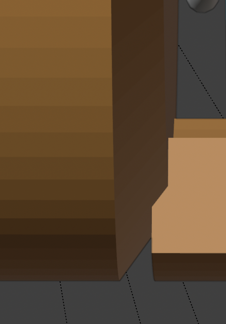

</image>

## 164

下面的装开关的圆柱，最好留两个小孔出来用于接导线

## 165

上面蓝色插销要和键帽一体，内部撞针，然后这样上下两个部分像插销卡在一起

## 166

键帽下面的蓝色部分，没有融合在一起

## 167

不是这个，我是说蓝色侧面4个片跟上面平面没有连在一起

## 168

其实你这个蓝色的结构就跟下面黄色要基本一样，只不是内部多了个撞针

## 169

<image name=[Image #1] path="[本机路径已脱敏]">

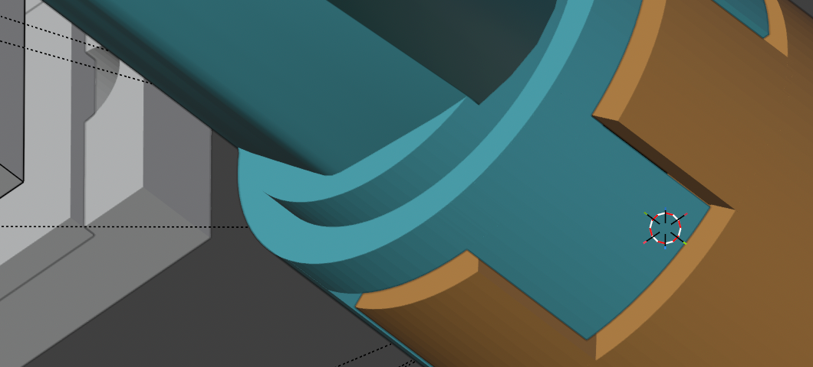

</image>

## 170

这样，吧他们分开，蓝色，弹簧，黄色，开关

## 171

<image name=[Image #1] path="[本机路径已脱敏]">

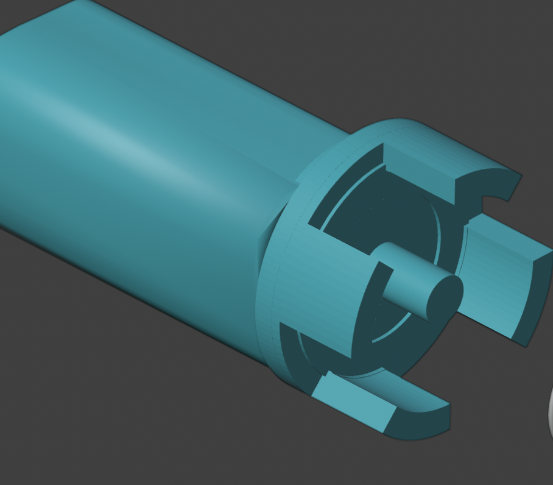

</image>

## 172

<image name=[Image #1] path="[本机路径已脱敏]">

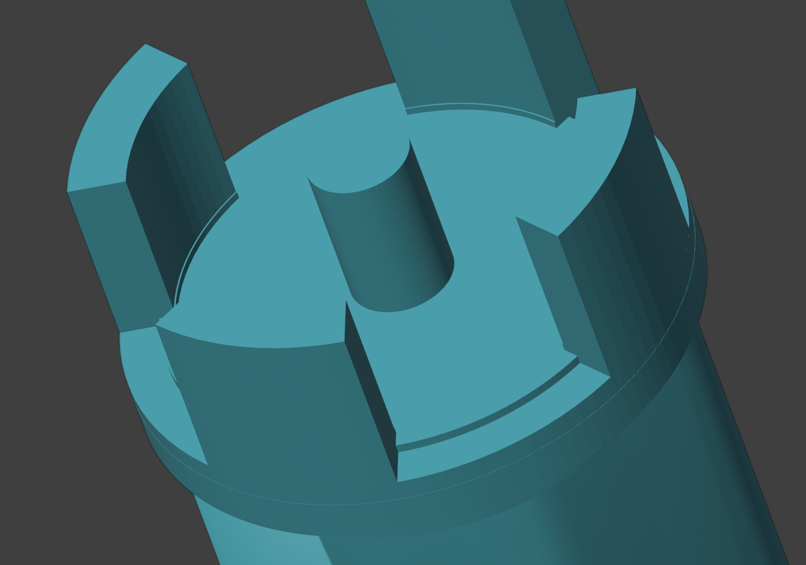

</image>

## 173

键帽底部直接连在圆盘底座上

## 174

黄色内部做成6x6的正方形，这样插件开关好卡死

## 175

蓝色上圆盘和下圆盘不是一体啊

## 176

撞针根部最好和弹簧内径一样，这样弹簧卡得紧

## 177

黄色放弹簧的位置也需要按照弹簧内经做一个圆弧，卡上去

## 178

你算一下手柄这个总体高度，看看能不能放得下

## 179

键帽底座哪个圆盘可以减少3/4

## 180

是的厚度

## 181

键帽内部可以是空心的

## 182

这个圆弧插销，会不会卡的不紧，考虑内外径，做成燕尾榫的结构这样在左右方向不容易晃动

## 183

不是这个方向做成榫卯结构，是内外径的切角做大一些

## 184

你这个蓝色的插销做的坑坑洼洼的

## 185

你这样斜切，那相互之间都插不进去了

## 186

还原成之前正规圆弧吧

## 187

所以我说的是，在这个规则圆弧的基础上，黄色的片内径小点，蓝色的相应内径大点

## 188

<image name=[Image #1] path="[本机路径已脱敏]">

</image>

## 189

<image name=[Image #1] path="[本机路径已脱敏]">

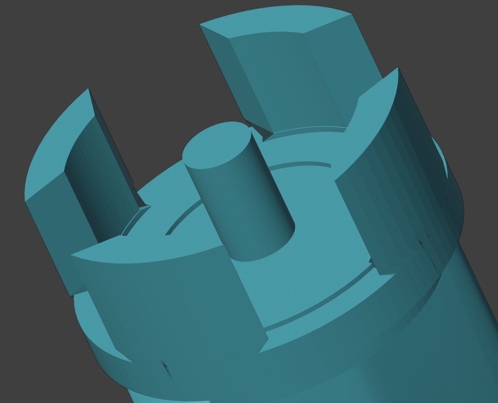

</image>

## 190

蓝色的圆盘还是有很多

## 191

<image name=[Image #1] path="[本机路径已脱敏]">

</image>

## 192

键帽直接连接在刚才插销的圆盘上，不要多处一个圆盘

## 193

<image name=[Image #1] path="[本机路径已脱敏]">

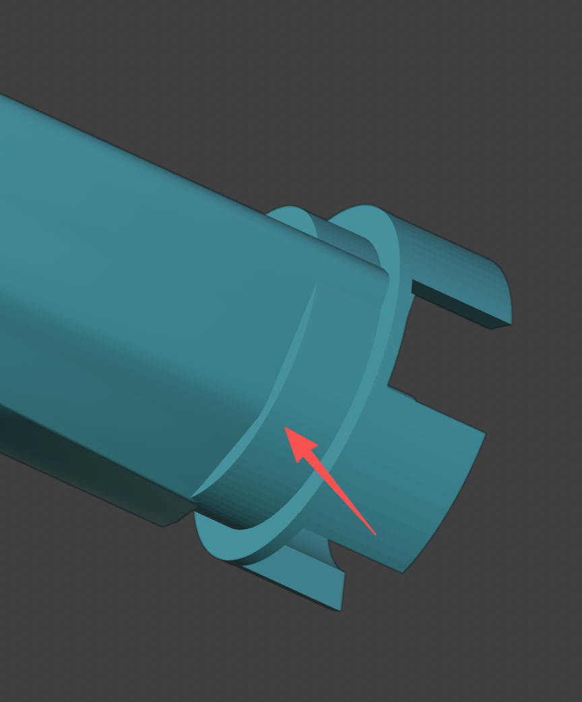

</image>

## 194

<image name=[Image #1] path="[本机路径已脱敏]">

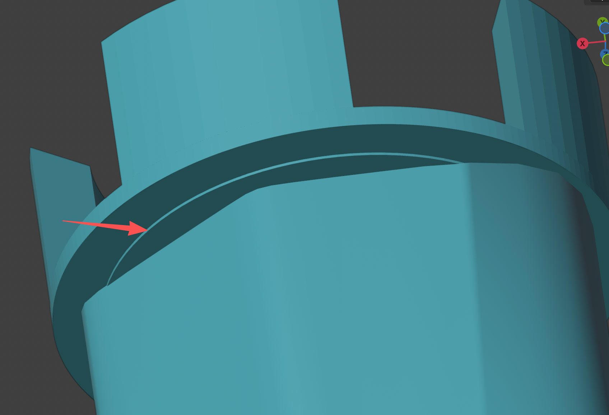

</image>

## 195

插销内部的圆盘底部需要给弹簧提供一个卡座圆环

## 196

黄色那边也要

## 197

<image name=[Image #1] path="[本机路径已脱敏]">

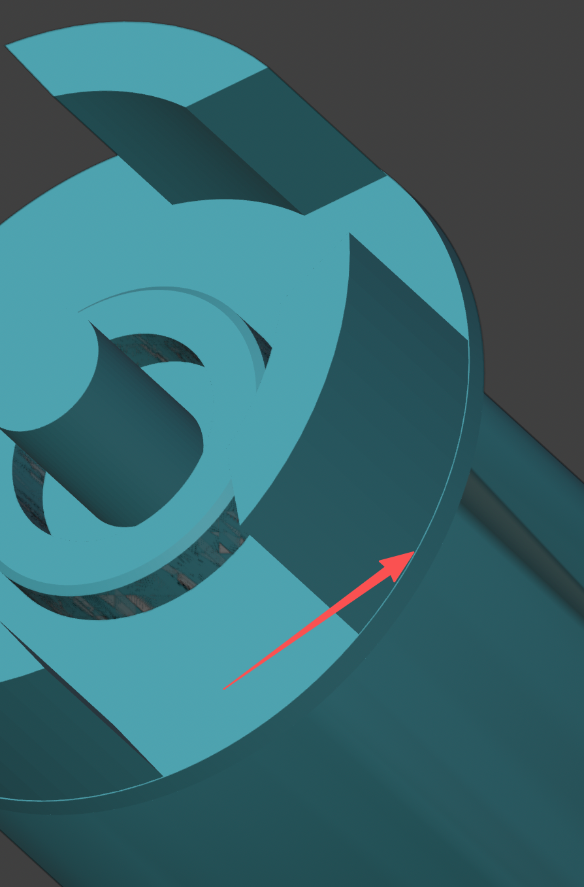

</image>

## 198

改得不好，把键帽也动了吧

## 199

四块组装起来，用网格看看有没有问题

## 200

尤其是插销，有没有严丝合缝

## 201

没有相交，但是插销之间缝隙是不是有点大

## 202

再小店，你小了我可以磨，大了我没东西加

## 203

你看这个总成的高度能不能装到手柄里面

## 204

弹簧定位环需要和底座是一体

## 205

再展开看看

## 206

黄色内部应该用矩形6x6，这样开关可以嵌入进去，卡死

## 207

你怎么把底部的孔盖住了，这样的话开关还怎么被顶针撞击

## 208

黄色底部那个圆台厚度要和蓝色一样，不然开关扣进去都没法冒出去

## 209

方形内径也要延长

## 210

这个方块内劲移除吧

## 211

把开关塞进去

## 212

把上海喜爱左右四个按键，组合在一起，装配进手柄看看效果

## 213

装进壳子里啊

## 214

所以你看，这个键帽有点小了

## 215

你保留这个手柄的上下左右，以及右边abxy的设计，其他的部分采用之前puretv的手柄两者进行融合

## 216

这个不够光滑，你还是用ps5的吧，然后其他地方填充掉

## 217

前面面板做成一整块，平滑的，相同颜色

## 218

我是说mesh融合在一起，中间不要有缝隙，平滑过渡

## 219

你还是将这个按键移植到之前puretv手柄吧，然后优化样式

## 220

左边按键部分要像ps5那样饱满一些

## 221

上表面外壳饱满点，参考ps5

## 222

<image name=[Image #1] path="[本机路径已脱敏]">

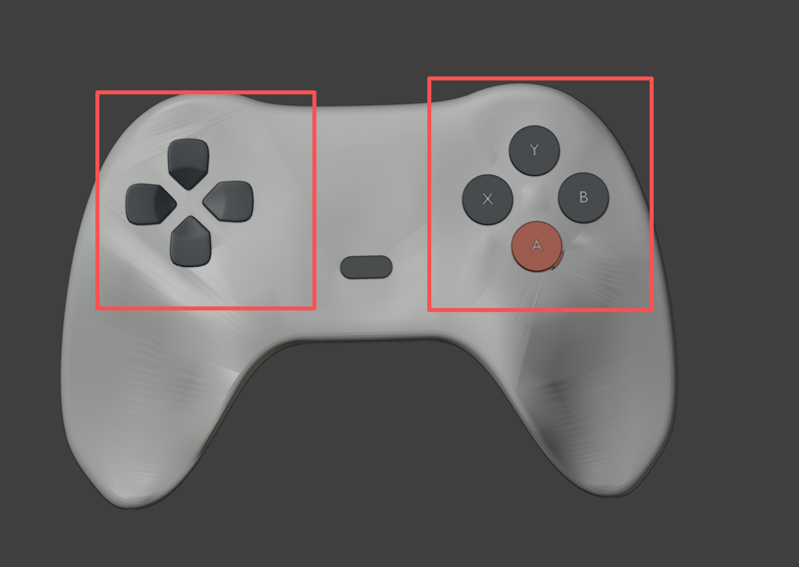

</image>

## 223

考虑吧ps5这块移植过来

## 224

还不够饱满

## 225

再平滑一点，整体效果考虑一下

## 226

平滑

## 227

褶皱太多了

## 228

按键位置周围再圆滑一些，确保按键在一个类似平面上，参考ps5

## 229

每个按键的平面突出高度需要一致

## 230

按键区域到其他地方平滑一些，有一些过渡

## 231

右边四个按键也做成插销的设计，跟左边一样

## 232

上盖拿起来我看看

## 233

左边按钮也要加底座固定

## 234

四个小底座能不能做成一个呢，这样只需要4个螺丝，也稳定

## 235

有一些问题，上盖盖上去之后，如何保证键帽在弹簧的作用下被顶出上盖；然后可以设计底部插销跟底座是按下去旋钮固定的，不用胶水粘

## 236

左边底座能不能放在痛一个平面呢，现在四个高低不一样

## 237

右侧abxy的键帽套壳柱，也不需要那么高吧，现在是弹簧的了，不是之前卡进去的了

## 238

按键底座的四个圆环需要嵌在一个方形的平面上，这样稳固一些

## 239

左边底座也要做成方形的

## 240

有缺口，然后右侧底座没有卡扣，abxy下面插销无法扣上去

## 241

底座有破面，然后固定螺丝应该周围4个，中间一个

## 242

<image name=[Image #1] path="[本机路径已脱敏]">

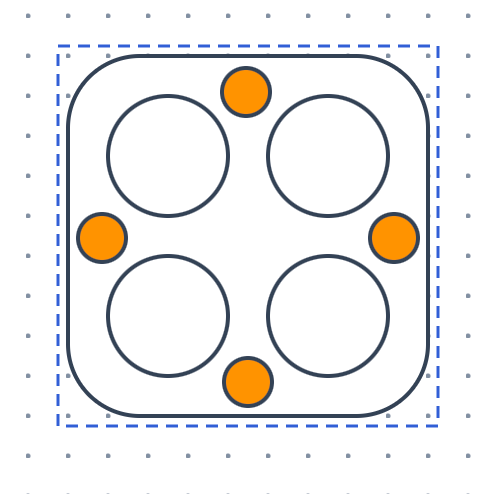

</image>

## 243

可以尝试在底板中间留一个孔洞，让所有的线从中间走下来，然后调整底部插销，让接线孔炒香中间孔洞

## 244

<image name=[Image #1] path="[本机路径已脱敏]">

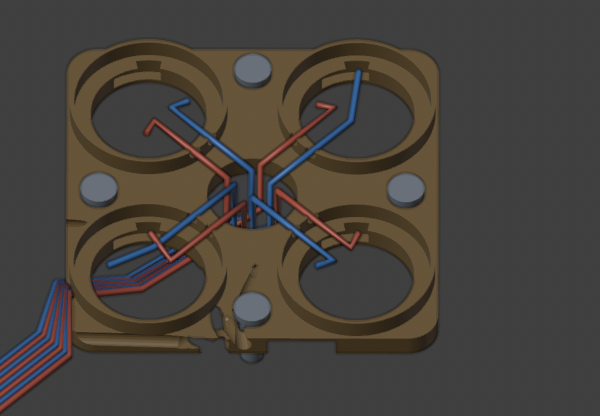

</image>

## 245

<image name=[Image #1] path="[本机路径已脱敏]">

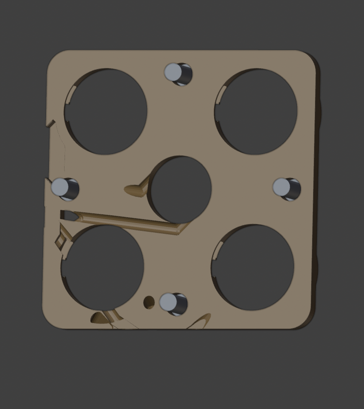

</image>

## 246

还有一个缺口，然后把模型散开，这样看的清楚些

## 247

左边底座还是有缺口

## 248

这些零件的实际验证很麻烦，我建立了一个仓库 [https://github.com/ecojust/Mechanical-Simulation](https://github.com/ecojust/Mechanical-Simulation)；你把这些零件作为基础单元，放到素材里；然后把当前这个设计手柄的思路写进agents.md,并且所有的prompot历史用history文件夹存起来，这样后续工工作可以继续

## 249

接下来你继续优化这个手柄的结构

## 250

模型没有导入blender的编辑器中，用mcp
